<div align="center">


# Easy Edits

**An AI-assisted studio that turns long videos, quotes, news and music into short-form vertical content.**


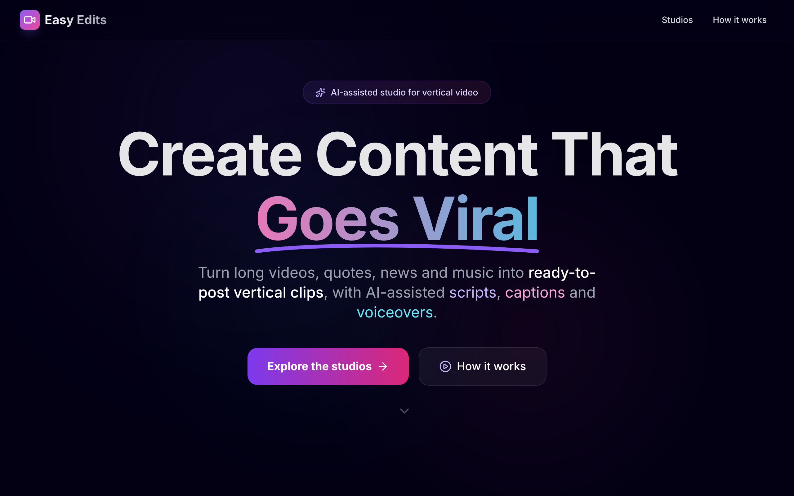

</div>

---

## Table of contents

- [Overview](#overview)
- [Screenshots](#screenshots)
- [Features](#features)
- [Tech stack](#tech-stack)
- [Architecture](#architecture)
- [Project structure](#project-structure)
- [Getting started](#getting-started)
- [Configuration](#configuration)
- [Running the app](#running-the-app)
- [Usage](#usage)
- [Scripts](#scripts)
- [API reference](#api-reference)
- [Testing](#testing)
- [Linting and formatting](#linting-and-formatting)
- [Accessibility and UX](#accessibility-and-ux)
- [Deployment](#deployment)
- [Troubleshooting and FAQ](#troubleshooting-and-faq)
- [Known limitations](#known-limitations)
- [Roadmap](#roadmap)
- [Contributing](#contributing)
- [License](#license)

## Overview

Making short-form video (TikTok, Instagram Reels, YouTube Shorts) usually means juggling a
downloader, a video editor, a captioning tool, a text-to-speech service, a stock-footage site
and a chatbot for scripts. Easy Edits puts those steps behind one interface.

It is a **React single-page app** backed by an **Express "media API"** that runs on your own
machine. The API orchestrates `yt-dlp`, FFmpeg, ImageMagick and a few Python computer-vision
scripts, and calls AI providers (Google Gemini, OpenRouter, Speechify) with keys that never leave
the server.

Each content niche gets its own **studio** with a workflow tuned to that format: grab a clip,
reframe it to 9:16, add captions, a voiceover, B-roll, music or filters, preview each step, and
download the result.

**Who it's for:** solo creators and small teams who post vertical video and are comfortable
running a local Node.js app, plus developers who want a working reference for wiring media tools
and LLM APIs together.

> [!IMPORTANT]
> This is a personal project meant to run **locally**. The API has no authentication or rate
> limiting, spawns heavy processes and calls paid APIs, so do not expose it to the public
> internet as-is. See [Deployment](#deployment).

## Screenshots

All screenshots were captured from the running app with Playwright. No API keys were configured
in the capture environment, so screens that need an AI provider show either their empty state or
the friendly "key not configured" message.

| Studios (desktop)                                                                                                              | Phone (375 px)                                                                           |
| ------------------------------------------------------------------------------------------------------------------------------ | ---------------------------------------------------------------------------------------- |
| 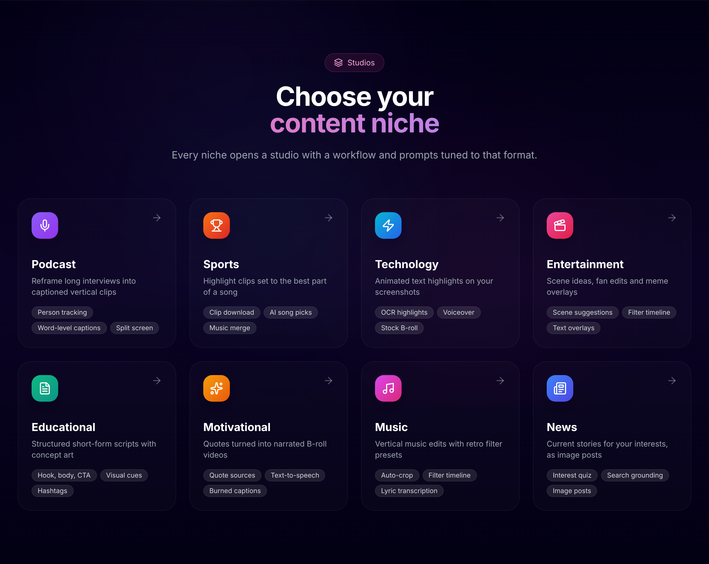 | 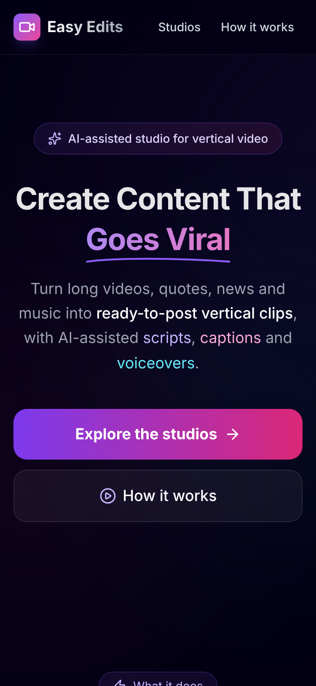 |

| Podcast Studio                                                                                                                                                         | Podcast Studio (phone)                                                                        |
| ---------------------------------------------------------------------------------------------------------------------------------------------------------------------- | --------------------------------------------------------------------------------------------- |
| 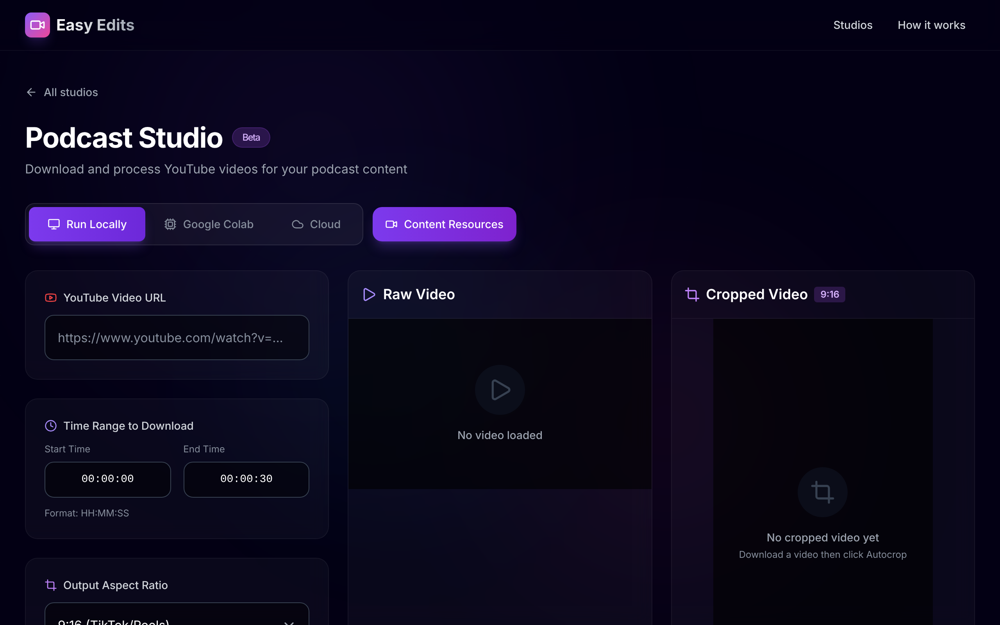 | 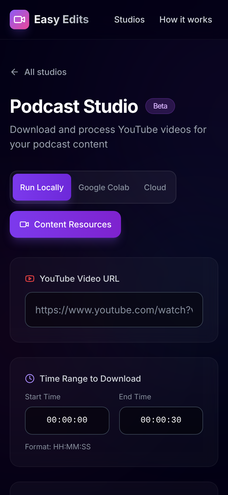 |

<details>
<summary><strong>More screens</strong> (Generator, Text Highlighter, Music, Sports, Motivational, Movie &amp; TV, News, 404)</summary>

**Script Generator.** The script content in this capture came from a stubbed
`/api/generator/script` response (no Gemini key was available). The layout, tabs and rendering
are the real UI.

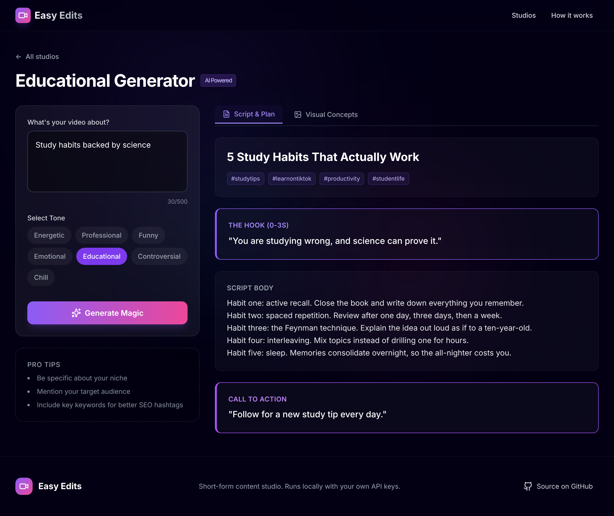

**Text Highlighter (Tech)**

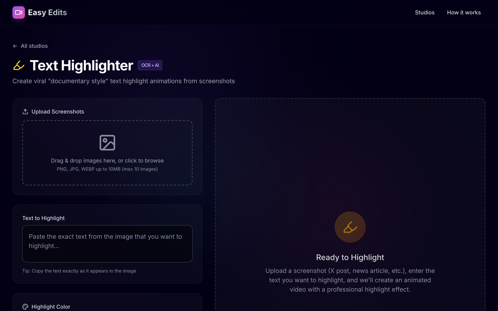

**Music Studio**

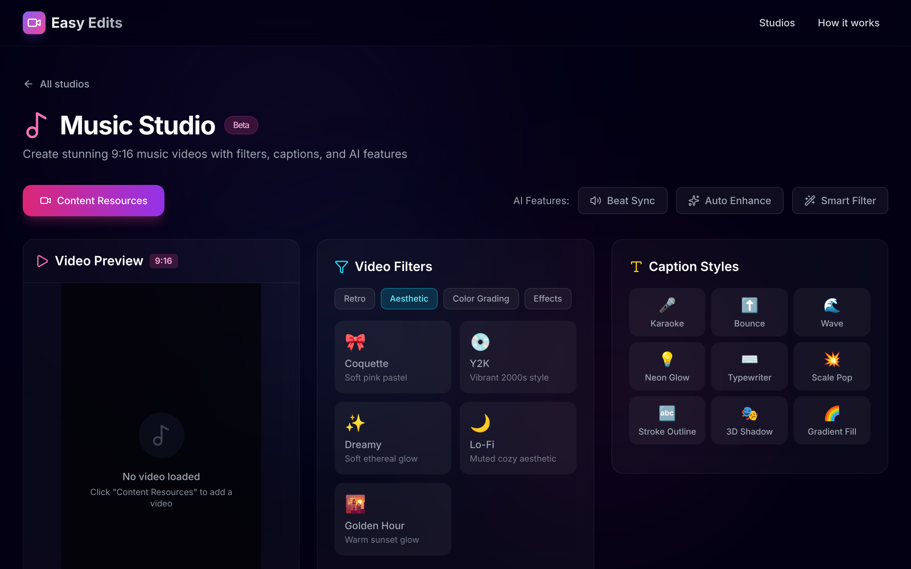

**Sports Studio**

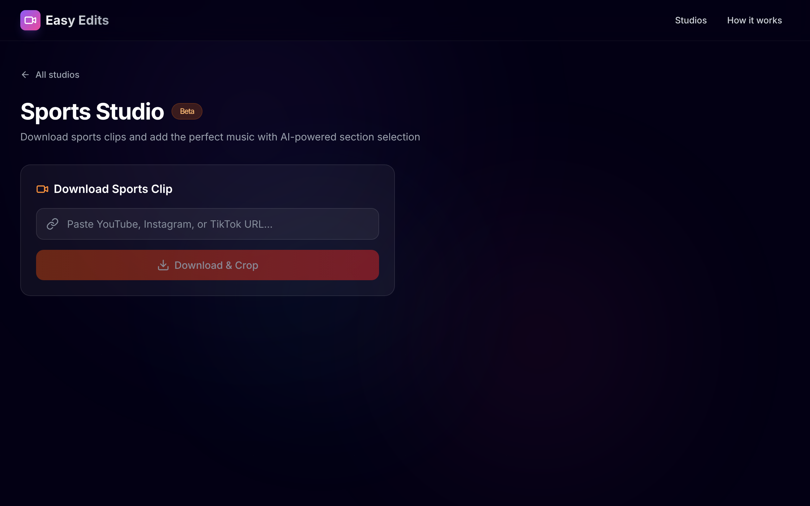

**Motivational Studio**

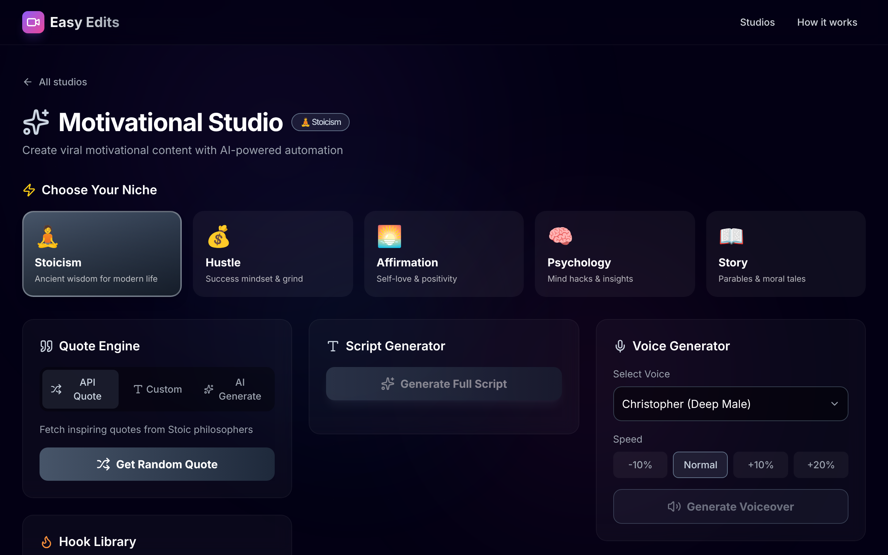

**Movie & TV Studio**

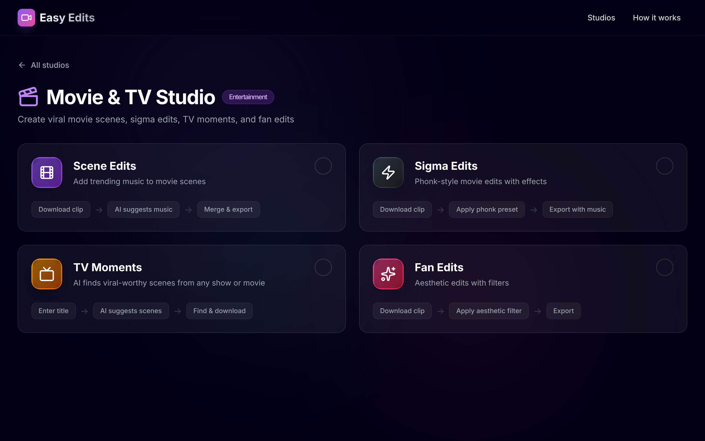

**News Studio** without a Gemini key: the server's message is shown inline with a retry button.

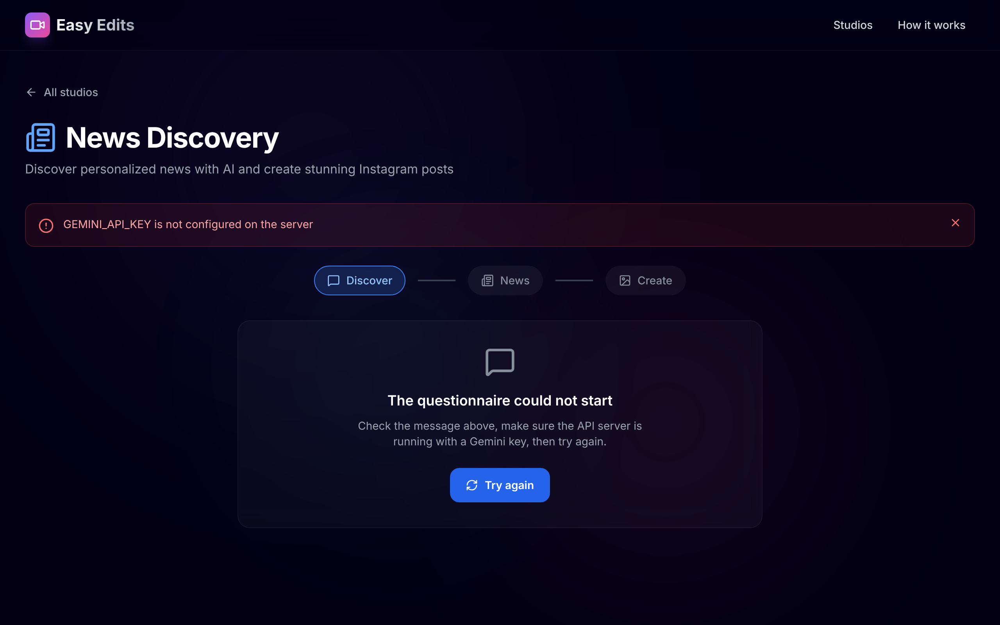

**Not-found page** for unknown links

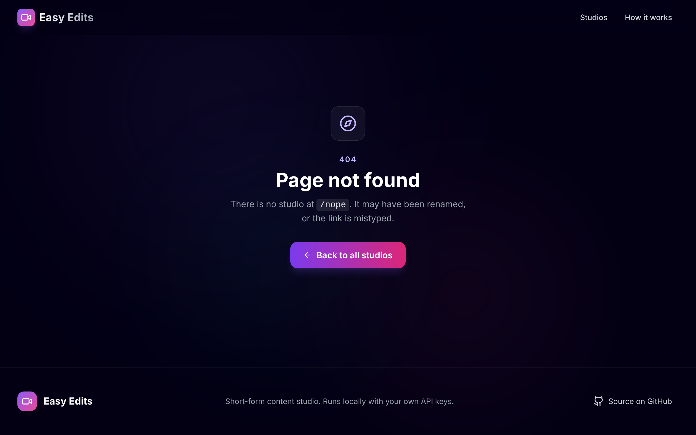

</details>

## Features

### Studios

| Studio                             | Route                     | What it does                                                                                                                                                                                                                                                                                        | Needs                                                                       |
| ---------------------------------- | ------------------------- | --------------------------------------------------------------------------------------------------------------------------------------------------------------------------------------------------------------------------------------------------------------------------------------------------- | --------------------------------------------------------------------------- |
| **Podcast**                        | `#/studio/podcast`        | Download a time range from a YouTube video, reframe it to vertical with person tracking (locally or on a Colab GPU worker), crop letterboxed content, burn word-level captions in several themes, and build split-screen edits with AI-generated images (OpenRouter prompts + Pollinations images). | yt-dlp, FFmpeg, autocrop tools or Colab; OpenRouter for image prompts       |
| **Text Highlighter** (Technology)  | `#/studio/tech`           | Animate highlighted words on uploaded screenshots using OCR (EasyOCR + OpenCV), draft scripts and research resources (OpenRouter), generate voiceovers (Speechify) and search stock B-roll across Pexels, Pixabay and Unsplash.                                                                     | Python + EasyOCR; OpenRouter, Speechify, stock-footage keys (each optional) |
| **Music**                          | `#/studio/music`          | Download a music video, auto-crop to 9:16, apply FFmpeg filter presets on a timeline (VHS, Y2K, film grain…) and transcribe lyrics locally with Whisper.                                                                                                                                            | yt-dlp, FFmpeg; optional Whisper                                            |
| **Motivational**                   | `#/studio/motivational`   | Pull quotes from public quote APIs or generate them with Gemini, expand them into a hook and script, synthesise a voiceover with `edge-tts`, pick B-roll manually or let Gemini suggest YouTube clips, then assemble the final video with burned-in captions.                                       | FFmpeg, Python + edge-tts; Gemini for AI steps                              |
| **Sports**                         | `#/studio/sports`         | Crop a highlight clip, get Gemini song suggestions for the footage, preview and cut the best section of a track, and merge it with the video.                                                                                                                                                       | yt-dlp, FFmpeg; Gemini                                                      |
| **Movie & TV** (Entertainment)     | `#/studio/movie-tv`       | Search-grounded Gemini scene suggestions for a title, fan-edit downloads with a filter timeline, and meme-style AI text overlays (FFmpeg + ImageMagick).                                                                                                                                            | yt-dlp, FFmpeg, ImageMagick; Gemini                                         |
| **News**                           | `#/studio/news`           | A short Gemini questionnaire discovers your interests, fetches current stories with Google Search grounding, and turns a headline into an image post with Gemini image generation.                                                                                                                  | Gemini                                                                      |
| **Script Generator** (Educational) | `#/generator/educational` | Generates a structured short-form script (title, hook, body, CTA, visual cues, hashtags) and concept art.                                                                                                                                                                                           | Gemini                                                                      |

### Across the app

- **Every integration is optional.** Endpoints whose key is missing return `503` with the name of
  the variable to set, and the UI shows that message instead of failing silently.
- **Keys stay on the server.** The browser only talks to your API; nothing secret is compiled
  into the frontend bundle.
- **Optional GPU offload.** Long jobs (person-tracking crops, Whisper captions) can run on a free
  Google Colab GPU through Cloudflare R2 and a Firestore job queue.
- **Linkable studios.** Every studio has its own URL, the back button works, unknown links show
  a 404 page, and each page sets its own browser-tab title.
- **Responsive and accessible.** Checked at 375 px, 768 px and 1280 px, keyboard navigable, with
  a skip link, visible focus states and WCAG AA colour contrast (see
  [Accessibility and UX](#accessibility-and-ux)).
- **Hardened file and URL handling.** Client filenames are confined to `server/downloads/`, URLs
  are validated before they reach `yt-dlp` or a server-side `fetch`, and private/metadata hosts
  are blocked.

## Tech stack

| Layer            | Technology                                                                                      | Notes                                                          |
| ---------------- | ----------------------------------------------------------------------------------------------- | -------------------------------------------------------------- |
| Frontend         | [React 19](https://react.dev), [TypeScript](https://www.typescriptlang.org) (strict)            | Single-page app with a small hash router (`src/lib/router.ts`) |
| Build            | [Vite 6](https://vite.dev)                                                                      | Studios are code-split with `React.lazy`                       |
| Styling          | [Tailwind CSS 3](https://tailwindcss.com) via PostCSS, [lucide-react](https://lucide.dev) icons | Design tokens in `tailwind.config.js`                          |
| API server       | [Node.js 22](https://nodejs.org), [Express 4](https://expressjs.com), Multer                    | CommonJS, `server/server.cjs`                                  |
| Media tooling    | yt-dlp, FFmpeg/ffprobe, ImageMagick 7                                                           | Spawned as child processes                                     |
| Python helpers   | Python 3.10+, EasyOCR, OpenCV, edge-tts, optional Whisper                                       | `server/*.py`, dependencies in `server/requirements.txt`       |
| AI providers     | Google Gemini (REST), OpenRouter, Speechify, Pollinations                                       | Called from the server only                                    |
| Stock media      | Pexels, Pixabay, Unsplash                                                                       | B-roll search                                                  |
| Cloud (optional) | Cloudflare R2 (S3 API), Firebase Firestore, Google Colab                                        | GPU job queue                                                  |
| Testing          | [Vitest](https://vitest.dev), Testing Library, Supertest, jsdom                                 | Two projects: `web` and `server`                               |
| Quality          | ESLint 9 (flat config), Prettier, Ruff                                                          | Ruff covers the Python helpers                                 |

## Architecture

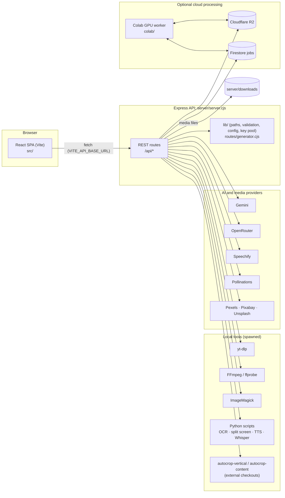

**How a request flows**

1. The SPA calls the API at `VITE_API_BASE_URL` (default `http://localhost:3005`). CORS only
   allows the origins in `CORS_ORIGINS`.
2. A route validates its input (`server/lib/validation.cjs`, `server/lib/paths.cjs`), then
   either spawns a local tool, calls an AI provider, or both.
3. Generated media is written to `server/downloads/` (git-ignored) and served back from
   `/api/videos/file/<name>`. Every client-supplied filename is resolved inside that folder.
4. For cloud jobs, the API uploads the input to R2 and creates a Firestore job. The Colab
   notebook polls for jobs, processes them on a GPU and uploads the result, which the UI polls
   for through `/api/cloud/jobs/:jobId`.

**Frontend structure**

- `App.tsx` owns the layout (skip link, navbar, `<main>`, footer) and renders the page for the
  current hash route. Studio pages are loaded lazily behind a loading indicator.
- `src/lib/router.ts` parses `#/studio/<name>` and `#/generator/<niche>` routes, builds links,
  and sets page titles. Hash URLs work on any static host without rewrite rules.
- `src/lib/api.ts` holds the API base URL and a `postJson` helper that turns server errors into
  readable messages.

## Project structure

```text
.
├── index.html                  # Vite entry: title, meta description, Open Graph tags, fonts
├── public/                     # favicon.svg, apple-touch-icon.png, og-image.png
├── src/
│   ├── main.tsx                # React bootstrap wrapped in an ErrorBoundary
│   ├── App.tsx                 # Layout, skip link, route switch, lazy-loaded studios
│   ├── App.test.tsx            # Routing, 404 and skip-link tests
│   ├── index.css               # Tailwind layers, focus styles, shared component classes
│   ├── types.ts                # ContentCategory, ScriptData, ViewState
│   ├── components/
│   │   ├── HomePage.tsx        # Landing page: hero, features, studio grid, how it works
│   │   ├── Navbar.tsx          # Fixed top navigation
│   │   ├── Footer.tsx
│   │   ├── Background.tsx      # Decorative gradient backdrop
│   │   ├── NotFoundPage.tsx    # 404 for unknown hash routes
│   │   ├── PageLoader.tsx      # Loading state while a studio chunk downloads
│   │   ├── ErrorBoundary.tsx   # Catches render errors with a "Try again" button
│   │   ├── Button.tsx          # Shared button with loading state
│   │   ├── Generator.tsx       # Script generator (Educational and other niches)
│   │   ├── PodcastPage.tsx     # Podcast studio
│   │   ├── TextHighlighterPage.tsx
│   │   ├── MusicPage.tsx
│   │   ├── MotivationalPage.tsx
│   │   ├── SportsPage.tsx
│   │   ├── MovieTVPage.tsx
│   │   ├── NewsPage.tsx
│   │   ├── TimelineEditor.tsx  # Filter timeline used by Music / Movie & TV
│   │   └── *.test.tsx          # Component tests
│   ├── lib/
│   │   ├── api.ts              # API base URL, mediaUrl(), postJson(), error helpers
│   │   ├── router.ts           # Hash router, route titles, niche → studio mapping
│   │   └── site.ts             # Repository URL
│   ├── services/generatorApi.ts # Typed client for /api/generator
│   └── test/setup.ts           # jest-dom matchers and cleanup
├── server/
│   ├── server.cjs              # Express app and media routes (exports `app` for tests)
│   ├── routes/generator.cjs    # POST /api/generator/script and /concept-image
│   ├── lib/
│   │   ├── config.cjs          # Port, CORS, body limit, model ids from env
│   │   ├── paths.cjs           # resolveInside(): keeps filenames inside a directory
│   │   ├── validation.cjs      # URL, timestamp and SSRF checks
│   │   ├── geminiKeys.cjs      # Gemini key pool with rotation on rate limits
│   │   └── scriptGenerator.cjs # Prompt building and response parsing
│   ├── cloudStorage.cjs        # Cloudflare R2 client
│   ├── jobQueue.cjs            # Firestore job queue (firebase-admin modular API)
│   ├── text_highlighter.py     # OCR word highlighting
│   ├── split_screen_composer.py
│   ├── content_creator.py      # OpenRouter content scripts
│   ├── extract_tweet_with_pfp.py # Standalone utility (needs gallery-dl)
│   ├── requirements.txt        # Python dependencies
│   ├── .env.example            # Annotated server configuration
│   ├── downloads/              # Generated media (git-ignored)
│   └── test/                   # API unit and integration tests
├── colab/                      # Colab GPU worker notebook, helpers and setup guide
├── docs/
│   ├── next-steps.md           # Roadmap notes
│   ├── images/                 # Concept artwork
│   └── screenshots/            # README screenshots
├── .github/workflows/ci.yml    # Lint, format, type-check, test, build, audit, Ruff
├── eslint.config.js · .prettierrc.json · ruff.toml
├── tailwind.config.js          # Design tokens (brand, gray, surface)
└── vite.config.ts              # Dev server, chunking and Vitest projects
```

## Getting started

### Prerequisites

| Requirement                                       | Version | Needed for                                        | Check with          |
| ------------------------------------------------- | ------- | ------------------------------------------------- | ------------------- |
| [Node.js](https://nodejs.org) and npm             | 22+     | Everything (`.nvmrc` pins 22)                     | `node -v`           |
| [yt-dlp](https://github.com/yt-dlp/yt-dlp)        | recent  | Downloading clips                                 | `yt-dlp --version`  |
| [FFmpeg](https://ffmpeg.org) (incl. `ffprobe`)    | 5+      | Cropping, filters, captions, merging              | `ffmpeg -version`   |
| [Python](https://www.python.org)                  | 3.10+   | OCR highlighter, split screen, TTS, transcription | `python3 --version` |
| [ImageMagick](https://imagemagick.org) (`magick`) | 7       | Movie & TV meme overlays                          | `magick -version`   |

The landing page, the script generator and every studio's UI run with **only Node.js**. The other
tools are needed only by the studios that use them, and missing tools produce a clear error.

<details>
<summary>Installing the media tools</summary>

```bash
# macOS (Homebrew)
brew install node@22 yt-dlp ffmpeg imagemagick python@3.12

# Debian / Ubuntu
sudo apt install ffmpeg imagemagick python3 python3-venv
python3 -m pip install --user yt-dlp   # distro packages are often outdated

# Windows (winget)
winget install OpenJS.NodeJS.LTS yt-dlp.yt-dlp Gyan.FFmpeg ImageMagick.ImageMagick Python.Python.3.12
```

</details>

### Installation

1. **Clone and install the JavaScript dependencies**

   ```bash
   git clone https://github.com/jeevithg090/EasyEdits.git
   cd EasyEdits
   npm install
   ```

2. **(Optional) Install the Python helpers.** The server prefers `server/venv/bin/python` when it
   exists.

   ```bash
   python3 -m venv server/venv
   server/venv/bin/pip install -r server/requirements.txt
   # Optional, large (PyTorch): local lyric transcription for the Music studio
   # server/venv/bin/pip install openai-whisper
   ```

3. **(Optional) Add the auto-crop tools.** The vertical reframing features expect two external
   tools next to the server, each with its own `venv`:

   - `server/autocrop-vertical/`: a YOLO-based person-tracking cropper exposing `main.py`
   - `server/autocrop-content/`: [paulpierre/autocrop](https://github.com/paulpierre/autocrop)
     (`autocrop-cli.py`)

   Both paths are git-ignored. Without them the crop endpoints return a clear error and the rest
   of the app keeps working. You can also use the Colab worker instead.

4. **Create your configuration files**

   ```bash
   cp server/.env.example server/.env   # API keys and server settings
   cp .env.example .env.local           # optional: where the frontend finds the API
   ```

   Fill in only the keys you have. See [Configuration](#configuration).

5. **Start everything**

   ```bash
   npm run dev:all
   ```

   Open <http://localhost:3000>. The API runs on <http://localhost:3005>; check it with
   `curl http://localhost:3005/api/health`.

## Configuration

### API server (`server/.env`)

| Variable                          | Required                        | Default                                       | Description                                                            |
| --------------------------------- | ------------------------------- | --------------------------------------------- | ---------------------------------------------------------------------- |
| `PORT`                            | No                              | `3005`                                        | Port the API listens on                                                |
| `CORS_ORIGINS`                    | No                              | `http://localhost:3000,http://127.0.0.1:3000` | Comma-separated allowed browser origins, or `*` for any                |
| `JSON_BODY_LIMIT`                 | No                              | `10mb`                                        | Maximum JSON request body size                                         |
| `GEMINI_API_KEY`                  | For Gemini features             | none                                          | Scripts, news, scene/song/B-roll suggestions, image generation         |
| `GEMINI_API_KEYS`                 | No                              | none                                          | Comma-separated extra keys, rotated when one is rate limited           |
| `GEMINI_API_KEY_1`, `_2`          | No                              | none                                          | Alternative way to provide extra keys                                  |
| `GEMINI_TEXT_MODEL`               | No                              | `gemini-2.5-flash`                            | Text model id                                                          |
| `GEMINI_IMAGE_MODEL`              | No                              | `gemini-2.5-flash-image`                      | Image model id                                                         |
| `OPENROUTER_API_KEY`              | For OpenRouter features         | none                                          | Split-screen image prompts, content scripts, B-roll keyword extraction |
| `SPEECHIFY_API_KEY`               | For Text Highlighter voiceovers | none                                          | Speechify text-to-speech                                               |
| `PEXELS_API_KEY`                  | No                              | none                                          | Stock B-roll search                                                    |
| `PIXABAY_API_KEY`                 | No                              | none                                          | Stock B-roll search                                                    |
| `UNSPLASH_ACCESS_KEY`             | No                              | none                                          | Stock image search                                                     |
| `CLOUDFLARE_R2_ACCESS_KEY_ID`     | For cloud processing            | none                                          | R2 access key                                                          |
| `CLOUDFLARE_R2_SECRET_ACCESS_KEY` | For cloud processing            | none                                          | R2 secret                                                              |
| `CLOUDFLARE_R2_ENDPOINT`          | For cloud processing            | none                                          | `https://<account-id>.r2.cloudflarestorage.com`                        |
| `CLOUDFLARE_R2_BUCKET_NAME`       | For cloud processing            | `easy-edits-videos` (in the example file)     | Bucket for job inputs and outputs                                      |
| `CLOUDFLARE_R2_PUBLIC_URL`        | No                              | none                                          | Public bucket URL if exposed through a custom domain                   |
| `FIREBASE_SERVICE_ACCOUNT_JSON`   | For cloud processing (one of)   | none                                          | Service-account JSON as a single-line string                           |
| `FIREBASE_SERVICE_ACCOUNT_PATH`   | For cloud processing (one of)   | `server/firebase-service-account.json`        | Path to the service-account file (git-ignored at the default location) |

[`server/.env.example`](server/.env.example) contains the same list with links to where each key
is created.

### Frontend (`.env.local`)

| Variable            | Required | Default                 | Description                                       |
| ------------------- | -------- | ----------------------- | ------------------------------------------------- |
| `VITE_API_BASE_URL` | No       | `http://localhost:3005` | Base URL of the API server, compiled into the SPA |

> [!WARNING]
> `VITE_*` values are embedded in the public JavaScript bundle. Never put secrets there.

### Colab worker

The notebook in `colab/` reads its R2 and Firebase settings from **Colab Secrets**. Setup steps
are in [`colab/COLAB_WORKER_NOTEBOOK.md`](colab/COLAB_WORKER_NOTEBOOK.md).

## Running the app

### Development

```bash
npm run dev:all     # Vite on :3000 and the API on :3005, with prefixed logs
```

Or in two terminals:

```bash
npm run dev         # frontend with hot reload
npm run server      # API server
```

### Production

```bash
npm run build       # type-check, then build the SPA into dist/
npm run preview     # serve dist/ locally on :4173 to check the build
npm run server      # run the API (use a process manager such as pm2 or systemd)
```

When the frontend is served from another origin, build it with that API URL and allow the
origin on the server:

```bash
VITE_API_BASE_URL=https://api.example.com npm run build
# in server/.env
CORS_ORIGINS=https://studio.example.com
```

## Usage

### UI walkthrough

1. **Pick a studio.** Open <http://localhost:3000> and choose a niche under _Studios_. Each card
   is a link, so you can open studios in new tabs or bookmark them (for example
   <http://localhost:3000/#/studio/podcast>).
2. **Bring your source.**
   - _Podcast_: paste a YouTube URL, set a start and end time (`HH:MM:SS`), choose an aspect
     ratio and click **Download Clip**. Then use **Autocrop** to reframe to 9:16 and add
     captions.
   - _Text Highlighter_: drag in up to 10 screenshots (PNG, JPG or WEBP, 10 MB each), type the
     text to highlight, pick a colour and generate the animation.
   - _Motivational_: pick a niche, fetch or generate a quote, expand it into a script, generate
     a voiceover, choose B-roll and assemble.
   - _Script Generator_: describe your topic, pick a tone and click **Generate Magic**.
3. **Review and download.** Every step shows a preview. Finished files are listed under
   _Processed Videos_ and can be downloaded or deleted.

If a step needs a key or tool you have not set up, the studio shows the server's message (for
example `GEMINI_API_KEY is not configured on the server`) and a way to retry.

### API examples

Health check:

```bash
curl http://localhost:3005/api/health
```

```json
{ "status": "ok", "timestamp": "2026-11-14T22:40:33.353Z" }
```

Generate a script (needs `GEMINI_API_KEY`):

```bash
curl -X POST http://localhost:3005/api/generator/script \
  -H 'Content-Type: application/json' \
  -d '{"category":"Educational","topic":"Study habits backed by science","tone":"Chill"}'
```

```json
{
  "script": {
    "title": "…",
    "hook": "…",
    "script_body": "…",
    "cta": "…",
    "visual_cues": ["…"],
    "hashtags": ["…"]
  }
}
```

Without a key the same call returns `503`:

```json
{ "error": "Gemini API key is not configured on the server" }
```

Download a clip (needs `yt-dlp` and FFmpeg):

```bash
curl -X POST http://localhost:3005/api/download \
  -H 'Content-Type: application/json' \
  -d '{"url":"https://www.youtube.com/watch?v=VIDEO_ID","startTime":"00:01:00","endTime":"00:01:30"}'
```

```json
{
  "success": true,
  "filename": "video_1731624000000.mp4",
  "videoPath": "/api/videos/file/video_1731624000000.mp4",
  "message": "Video downloaded successfully"
}
```

List processed videos:

```bash
curl http://localhost:3005/api/videos
# [{"filename":"…mp4","path":"/api/videos/file/…mp4","size":1234567,"createdAt":"…"}]
```

Errors are always JSON with an `error` field. Validation failures return `400`, missing keys
`503`, unknown routes `404`:

```bash
curl -X DELETE 'http://localhost:3005/api/videos/..%2Fserver.cjs'
# {"error":"Invalid filename"}
```

## Scripts

| Command                                       | Description                                                |
| --------------------------------------------- | ---------------------------------------------------------- |
| `npm run dev`                                 | Start the Vite dev server on port 3000                     |
| `npm run server`                              | Start the API server (`server/server.cjs`)                 |
| `npm run dev:all`                             | Start both with `concurrently`                             |
| `npm run build`                               | Type-check (`tsc --noEmit`) and build the SPA into `dist/` |
| `npm run preview`                             | Serve the production build                                 |
| `npm test`                                    | Run every test once (web + server)                         |
| `npm run test:watch`                          | Run tests in watch mode                                    |
| `npm run test:coverage`                       | Run tests with a V8 coverage report                        |
| `npm run typecheck`                           | TypeScript only                                            |
| `npm run lint` / `npm run lint:fix`           | ESLint (check / fix)                                       |
| `npm run format` / `npm run format:check`     | Prettier (write / check)                                   |
| `ruff check . && ruff format --check .`       | Lint and format-check the Python helpers                   |
| `python -m py_compile server/*.py colab/*.py` | Syntax-check the Python files                              |

## API reference

All routes are served by `server/server.cjs` under `http://localhost:3005`. **None require
authentication** (see [Deployment](#deployment)). Bodies are JSON unless marked _multipart_.

<details open>
<summary><strong>Core and media files</strong></summary>

| Method | Path                           | Auth | Description                                                   |
| ------ | ------------------------------ | ---- | ------------------------------------------------------------- |
| GET    | `/api/health`                  | None | Liveness check                                                |
| GET    | `/api/videos`                  | None | List processed `.mp4`/`.webm` files, newest first             |
| GET    | `/api/videos/file/<name>`      | None | Serve a file from `server/downloads/`                         |
| DELETE | `/api/videos/:filename`        | None | Delete a processed file (confined to `server/downloads/`)     |
| POST   | `/api/download`                | None | Download a YouTube time range (`url`, `startTime`, `endTime`) |
| POST   | `/api/autocrop`                | None | Reframe a downloaded video to vertical with person tracking   |
| POST   | `/api/content-crop`            | None | Download a video and crop letterboxed content (`videoUrl`)    |
| POST   | `/api/fan-edit/download`       | None | Download a clip for a fan edit                                |
| GET    | `/api/caption-themes`          | None | Available caption fonts and colours                           |
| POST   | `/api/generator/script`        | None | Structured script (`category`, `topic`, `tone`); needs Gemini |
| POST   | `/api/generator/concept-image` | None | Concept art as a data URL (`description`); needs Gemini       |

</details>

<details>
<summary><strong>Cloud processing (R2 + Firestore + Colab)</strong></summary>

| Method | Path                                       | Auth | Description                                  |
| ------ | ------------------------------------------ | ---- | -------------------------------------------- |
| GET    | `/api/cloud/status`                        | None | Whether R2 and Firestore are connected       |
| POST   | `/api/cloud/upload`                        | None | Upload a video to R2 and queue a job         |
| GET    | `/api/cloud/jobs`                          | None | List recent jobs                             |
| GET    | `/api/cloud/jobs/:jobId`                   | None | Job status                                   |
| GET    | `/api/cloud/result/:jobId`                 | None | Signed URL for a finished job's output       |
| GET    | `/api/cloud/jobs/:jobId/transcription`     | None | Word-level transcription from the worker     |
| POST   | `/api/cloud/jobs/:jobId/generate-captions` | None | Burn captions using a job's transcription    |
| POST   | `/api/download-cloud-video`                | None | Copy a cloud result into `server/downloads/` |

</details>

<details>
<summary><strong>Podcast split screen and AI images</strong></summary>

| Method | Path                           | Auth | Description                                  |
| ------ | ------------------------------ | ---- | -------------------------------------------- |
| POST   | `/api/generate-image-prompts`  | None | Image prompts from a transcript (OpenRouter) |
| POST   | `/api/generate-ai-images`      | None | Generate images for prompts (Pollinations)   |
| GET    | `/api/videos/file/ai_images/…` | None | Serve generated images                       |
| POST   | `/api/create-split-video`      | None | Compose a split-screen video                 |
| GET    | `/api/split-screen-options`    | None | Layout options                               |

</details>

<details>
<summary><strong>Text Highlighter, voiceover and B-roll</strong></summary>

| Method | Path                            | Auth | Description                                     |
| ------ | ------------------------------- | ---- | ----------------------------------------------- |
| POST   | `/api/text-highlight`           | None | _Multipart._ Animate highlighted text on images |
| GET    | `/api/text-highlight/colors`    | None | Highlight colour presets                        |
| POST   | `/api/create-content/script`    | None | Draft a script (OpenRouter)                     |
| POST   | `/api/create-content/resources` | None | Research resources for a topic (OpenRouter)     |
| GET    | `/api/audio/voices`             | None | Speechify voices                                |
| POST   | `/api/audio/generate`           | None | Generate a voiceover (Speechify)                |
| POST   | `/api/broll/extract-keywords`   | None | Keywords for B-roll search (OpenRouter)         |
| GET    | `/api/broll/search`             | None | Search one stock provider                       |
| GET    | `/api/broll/search-all`         | None | Search Pexels, Pixabay and Unsplash together    |
| POST   | `/api/broll/download`           | None | Download a stock clip into `server/downloads/`  |

</details>

<details>
<summary><strong>Music</strong></summary>

| Method | Path                                 | Auth | Description                                          |
| ------ | ------------------------------------ | ---- | ---------------------------------------------------- |
| POST   | `/api/music-video/download`          | None | Download and auto-crop a music video                 |
| GET    | `/api/music-video/filters`           | None | Filter presets                                       |
| POST   | `/api/music-video/apply-filter`      | None | Apply one filter                                     |
| POST   | `/api/music-video/process`           | None | Render a filter timeline and captions                |
| POST   | `/api/music-video/transcribe`        | None | Transcribe lyrics with local Whisper                 |
| POST   | `/api/music-video/ai-beat-detect`    | None | Beat markers (**placeholder data**, see limitations) |
| POST   | `/api/music-video/ai-suggest-filter` | None | Filter suggestions                                   |

</details>

<details>
<summary><strong>Motivational</strong></summary>

| Method | Path                                       | Auth | Description                             |
| ------ | ------------------------------------------ | ---- | --------------------------------------- |
| GET    | `/api/motivational/hooks`                  | None | Hook templates by category              |
| GET    | `/api/motivational/styles`                 | None | Video styles                            |
| GET    | `/api/motivational/niches`                 | None | Niches and their quote sources          |
| GET    | `/api/motivational/quote/:source`          | None | Fetch a quote from a public quote API   |
| POST   | `/api/motivational/generate-quote`         | None | Generate a quote (Gemini)               |
| POST   | `/api/motivational/batch-generate`         | None | Generate several quotes                 |
| POST   | `/api/motivational/expand-script`          | None | Expand a quote into a hook and script   |
| GET    | `/api/motivational/voices`                 | None | edge-tts voices                         |
| POST   | `/api/motivational/generate-voice`         | None | Synthesise a voiceover with edge-tts    |
| GET    | `/api/motivational/broll-suggestions`      | None | B-roll suggestions                      |
| POST   | `/api/motivational/download-broll`         | None | Download a B-roll clip                  |
| POST   | `/api/motivational/ai-youtube-suggest`     | None | Gemini YouTube clip suggestions         |
| POST   | `/api/motivational/ai-youtube-resolve`     | None | Resolve a suggestion to a real video    |
| POST   | `/api/motivational/ai-youtube-alternative` | None | Ask for an alternative clip             |
| POST   | `/api/motivational/ai-youtube-download`    | None | Download the chosen clips               |
| POST   | `/api/motivational/ai-youtube-assemble`    | None | Assemble AI-picked clips into a video   |
| GET    | `/api/motivational/caption-styles`         | None | Caption styles                          |
| POST   | `/api/motivational/assemble-video`         | None | Assemble voiceover, B-roll and captions |

</details>

<details>
<summary><strong>Sports, Movie &amp; TV and News</strong></summary>

| Method | Path                                       | Auth | Description                                           |
| ------ | ------------------------------------------ | ---- | ----------------------------------------------------- |
| POST   | `/api/sports/ai-suggest-music`             | None | Song suggestions for a clip (Gemini)                  |
| POST   | `/api/sports/analyze-music`                | None | Pick the best section of a track                      |
| POST   | `/api/sports/download-music-section`       | None | Cut that section                                      |
| POST   | `/api/sports/merge-video-music`            | None | Merge the clip and the music                          |
| POST   | `/api/entertainment/suggest-scenes`        | None | Search-grounded scene ideas (Gemini)                  |
| POST   | `/api/entertainment/generate-text-overlay` | None | Meme-style text overlay (FFmpeg + ImageMagick)        |
| POST   | `/api/news/start-questionnaire`            | None | First interest question (Gemini)                      |
| POST   | `/api/news/next-question`                  | None | Next question from previous answers                   |
| POST   | `/api/news/finish-questionnaire`           | None | Summarise interests into a niche                      |
| POST   | `/api/news/fetch`                          | None | Current stories for a niche (Google Search grounding) |
| POST   | `/api/news/generate-image-prompt`          | None | Image prompt for a headline                           |
| POST   | `/api/news/generate-image-post`            | None | Generate the image post                               |

</details>

## Testing

```bash
npm test                 # all 151 tests, about 3 seconds
npm run test:coverage    # with a coverage report in coverage/
npx vitest run --project web     # frontend only (28 tests)
npx vitest run --project server  # API only (123 tests)
```

Vitest runs two projects (configured in `vite.config.ts`):

| Project  | Environment | What is covered                                                                                                                                                                                                                                                                                                          |
| -------- | ----------- | ------------------------------------------------------------------------------------------------------------------------------------------------------------------------------------------------------------------------------------------------------------------------------------------------------------------------ |
| `server` | Node        | Unit tests for path containment, URL/timestamp validation, configuration, the Gemini key pool and script parsing. Route tests for `/api/generator` with a stubbed Gemini client. Integration tests against the real Express app for path traversal, option injection, SSRF guards, CORS, JSON 404s and malformed bodies. |
| `web`    | jsdom       | Routing (studio links, 404 page, lazy-loaded generator, page titles, skip link), the hash router itself, the Generator flow (success, error and accessibility states), Button, Navbar, ErrorBoundary and the API client helpers.                                                                                         |

Tests make no network calls and need no API keys or media tools. The media pipelines that spawn
`yt-dlp`, FFmpeg or Python are **not** exercised end to end by the test suite.

## Linting and formatting

```bash
npm run lint             # ESLint 9 flat config: TypeScript, React hooks, React refresh
npm run format:check     # Prettier (100-column, single quotes)
npm run typecheck        # tsc in strict mode
ruff check . && ruff format --check .   # Python helpers
```

The repository's workflow in `.github/workflows/ci.yml` runs these checks, the tests, the
production build and `npm audit --omit=dev` on pushes and pull requests.

## Accessibility and UX

The UI was checked with Playwright and [axe-core](https://github.com/dequelabs/axe-core) on every
route (landing page, seven studios, generator and 404) at 375 px, 768 px and 1280 px.

- **Zero axe WCAG 2 A/AA violations** on the initial state of every route.
- **Keyboard:** a _Skip to content_ link is the first tab stop; route changes move focus to the
  main region; toggles expose `aria-pressed`; every control has a visible focus ring.
- **Forms:** labels are associated with their inputs; errors are announced with `role="alert"`
  and can be dismissed; the generator shows a character counter and a loading skeleton.
- **Contrast:** secondary text and white-on-colour buttons meet AA (4.5:1). The tokens that
  guarantee this live in `tailwind.config.js`.
- **Touch:** navigation links and primary buttons are at least 44 px tall; studio details are
  visible without hover.
- **Motion:** animations and smooth scrolling are disabled under `prefers-reduced-motion`, and
  the pointer-follow background effect only runs on fine-pointer devices.
- **Performance:** studios are lazy-loaded (the entry chunk is about 29 kB, plus shared React
  and icon chunks); only the UI font blocks rendering, caption fonts load asynchronously.
- **Dark only.** The app uses a single dark theme, which suits video previews. A light theme
  would need the studio pages' hard-coded dark colours moved to tokens first.

## Deployment

There is no hosted deployment. The two halves deploy separately:

1. **Frontend (static).** `npm run build` writes static files to `dist/`. Host them on any static
   host (Netlify, Vercel, Cloudflare Pages, GitHub Pages, nginx). Set `VITE_API_BASE_URL` at
   build time. Because routing uses the URL hash, no rewrite rules are needed.
2. **API (long-running).** Needs a VM or container with Node 22, `yt-dlp`, FFmpeg, ImageMagick and
   Python, plus a persistent disk for `server/downloads/`. Provide keys through environment
   variables and set `CORS_ORIGINS` to the frontend's origin. Run it under a process manager
   (pm2, systemd) behind a reverse proxy that terminates TLS.

**Before exposing the API to anyone but yourself**, add:

- authentication (for example a reverse proxy with basic auth or an identity-aware proxy),
- rate limiting, since endpoints spawn heavy processes and call paid APIs,
- a cleanup job for `server/downloads/`, which grows with every render.

## Troubleshooting and FAQ

<details>
<summary><strong>The UI says "GEMINI_API_KEY is not configured on the server".</strong></summary>

Add `GEMINI_API_KEY=…` to `server/.env` (not `.env.local`) and restart `npm run server`. Keys
are created at <https://aistudio.google.com/apikey>.

</details>

<details>
<summary><strong>Every request fails with "Failed to fetch" or a CORS error.</strong></summary>

- Is the API running? `curl http://localhost:3005/api/health`
- Does `VITE_API_BASE_URL` point at it? Restart `npm run dev` after changing `.env.local`.
- Is the frontend origin listed in `CORS_ORIGINS`? Opening the app via
  `http://<your-ip>:3000` needs that origin added.

</details>

<details>
<summary><strong>"Failed to start yt-dlp. Make sure yt-dlp is installed."</strong></summary>

Install `yt-dlp` and make sure it is on the `PATH` of the shell that runs the server. If
downloads start failing for a site that used to work, update it (`yt-dlp -U` or
`pip install -U yt-dlp`), since sites change often.

</details>

<details>
<summary><strong>Autocrop fails or says the tool was not found.</strong></summary>

The person-tracking crop needs the external `server/autocrop-vertical/` and
`server/autocrop-content/` checkouts, each with its own `venv` (see
[Installation](#installation), step 3). Alternatively, switch the Podcast studio to **Google
Colab** mode and run the worker notebook.

</details>

<details>
<summary><strong>The "Google Colab" mode is greyed out.</strong></summary>

It is enabled when `/api/cloud/status` reports both R2 and Firestore as connected. Set the
`CLOUDFLARE_R2_*` variables and one of the `FIREBASE_SERVICE_ACCOUNT_*` options, then restart the
server.

</details>

<details>
<summary><strong>Port 3000 or 3005 is already in use.</strong></summary>

Change `PORT` in `server/.env` (and `VITE_API_BASE_URL` to match), or start Vite on another port
with `npm run dev -- --port 3001` and add that origin to `CORS_ORIGINS`.

</details>

<details>
<summary><strong>Python helpers fail with "ModuleNotFoundError".</strong></summary>

Create `server/venv` and install `server/requirements.txt` into it. The server prefers that
interpreter over the system `python3`.

</details>

<details>
<summary><strong>Disk space keeps growing.</strong></summary>

Every download and render is written to `server/downloads/`. Delete files from the _Processed
Videos_ list in a studio, with `DELETE /api/videos/:filename`, or by clearing the folder while the
server is stopped.

</details>

## Known limitations

- `/api/music-video/ai-beat-detect` returns **placeholder** beat data.
- No real AI or media pipeline runs in the test suite; only request building, response parsing,
  validation and security guards are tested.
- OpenRouter free-tier model ids and some public quote APIs change over time. If a call starts
  failing, update the model list in `server/server.cjs`.
- Long renders hold the HTTP request open until they finish; there is no progress reporting for
  local jobs.
- `server/server.cjs` is a single ~6,700-line module and several studio pages exceed 1,000 lines.
- The UI is dark-only and English-only.

## Roadmap

Ideas, roughly in priority order (see also [`docs/next-steps.md`](docs/next-steps.md)):

1. Authentication and rate limiting for the API.
2. Real beat detection (FFmpeg audio analysis or `librosa`).
3. Split `server.cjs` into one router per studio, following `server/routes/generator.cjs`.
4. Background jobs with progress polling for local renders, as the cloud queue already does.
5. A retention policy for `server/downloads/`.
6. Smaller studio components with their own tests.
7. Move studio colours to design tokens and add an optional light theme.

## Contributing

Issues and pull requests are welcome.

1. Fork the repository and create a branch from `main`.
2. `npm install`, then make your change with tests where it makes sense.
3. Before pushing, run the same checks as the workflow:

   ```bash
   npm run lint && npm run format:check && npm run typecheck && npm test && npm run build
   ruff check . && ruff format --check .
   ```

4. Use [Conventional Commits](https://www.conventionalcommits.org) (`feat:`, `fix:`, `docs:` …)
   and describe how you verified the change in the pull request.

Please keep API keys out of commits; use `server/.env`, which is git-ignored.

## License

No license file is included yet, so the code is "all rights reserved" by default and others
cannot legally reuse it. If you want others to use and contribute to it, adding a permissive
license such as [MIT](https://choosealicense.com/licenses/mit/) is a common choice for a
portfolio project.

Third-party tools and services used by Easy Edits (yt-dlp, FFmpeg, ImageMagick, EasyOCR,
autocrop, Gemini, OpenRouter, Speechify, Pexels, Pixabay, Unsplash, Pollinations) are subject to
their own licenses and terms. Respect the copyright of any video or music you download and
publish.
