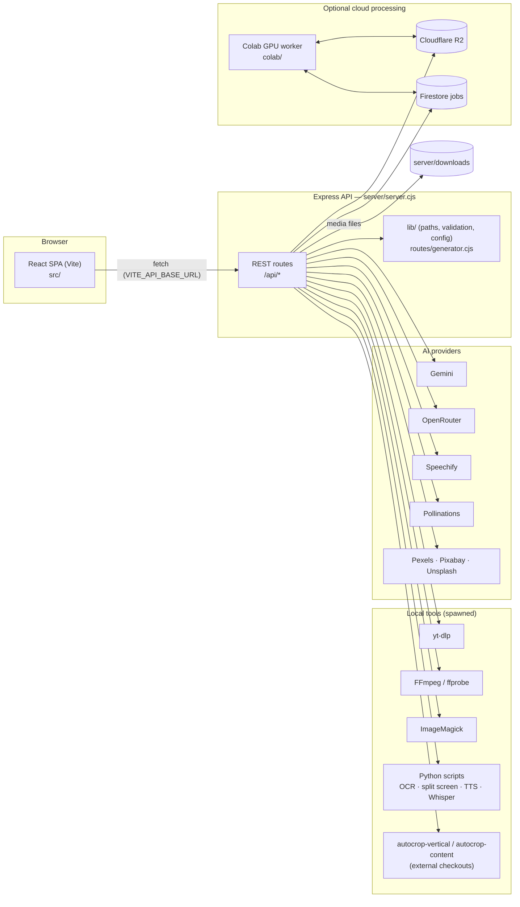

# Easy Edits

**An AI-assisted studio for turning long videos, quotes, news and music into short-form vertical content.**

Easy Edits is a React single-page app backed by an Express "media API" that orchestrates
`yt-dlp`, FFmpeg, Python computer-vision scripts and several AI providers. Each content niche
(podcast, sports, music, motivational, movie/TV, news, tech) gets its own studio with a workflow
tuned to that format: grab a clip, reframe it to 9:16, add captions, voiceover, B-roll or
filters, and download the result.

> **Status:** personal project, intended to run locally. The API has no authentication or rate
> limiting, so do not expose it to the public internet as-is (see [Deployment](#deployment)).

---

## Features

| Studio                       | What it does                                                                                                                                                                                                                                                                                        |
| ---------------------------- | --------------------------------------------------------------------------------------------------------------------------------------------------------------------------------------------------------------------------------------------------------------------------------------------------- |
| **Podcast**                  | Download a time range from a YouTube video, reframe it to vertical with person tracking (locally or on a Colab GPU worker), crop letterboxed content, burn word-level captions in several themes, and build split-screen edits with AI-generated images (OpenRouter prompts + Pollinations images). |
| **Text Highlighter** (Tech)  | Animate highlighted words on uploaded screenshots using OCR (EasyOCR + OpenCV), draft scripts and research resources (OpenRouter), generate voiceovers (Speechify), and search stock B-roll across Pexels, Pixabay and Unsplash.                                                                    |
| **Music**                    | Download a music video, auto-crop to 9:16, apply FFmpeg filter presets on a timeline (VHS, Y2K, film grain…), and transcribe lyrics locally with Whisper.                                                                                                                                           |
| **Motivational**             | Pull quotes from public quote APIs or generate them with Gemini, expand them into a hook/script, synthesise a voiceover with `edge-tts`, pick B-roll manually or let Gemini suggest YouTube clips, then assemble the final video with burned-in captions.                                           |
| **Sports**                   | Crop a highlight clip, get Gemini song suggestions for the footage, preview and cut the best section of a track, and merge it with the video.                                                                                                                                                       |
| **Movie & TV**               | Search-grounded Gemini scene suggestions for a title, fan-edit downloads with a filter timeline, and meme-style AI text overlays (FFmpeg + ImageMagick).                                                                                                                                            |
| **News**                     | A short Gemini questionnaire discovers your interests, fetches current stories with Google Search grounding, and turns a headline into an image post using Gemini image generation.                                                                                                                 |
| **Generator** (other niches) | Generates a structured short-form script (hook, body, CTA, visual cues, hashtags) and concept art with Gemini.                                                                                                                                                                                      |

Every integration is optional: endpoints whose API key is missing return a `503` naming the
variable to set, and the UI shows that message instead of failing silently.

## Tech stack

- **Frontend:** React 19, TypeScript (strict), Vite 6, Tailwind CSS 3, lucide-react
- **API server:** Node.js 22, Express 4, Multer (CommonJS)
- **Media tooling:** yt-dlp, FFmpeg/ffprobe, ImageMagick, Python 3 (EasyOCR, OpenCV, edge-tts, optional Whisper)
- **AI providers:** Google Gemini (REST), OpenRouter, Speechify, Pollinations
- **Optional cloud pipeline:** Cloudflare R2 (S3 API) + Firebase Firestore job queue + a Google Colab GPU worker
- **Tooling:** Vitest + Testing Library + Supertest, ESLint 9, Prettier, Ruff, GitHub Actions

## Architecture



- The browser never talks to AI providers directly; all keys stay on the server.
- Generated media is written to `server/downloads/` (git-ignored) and served from
  `/api/videos/file/<name>`. Every client-supplied filename is resolved inside that folder,
  and user URLs are validated before they reach `yt-dlp` or a server-side `fetch`.
- Long GPU jobs (person-tracking crop, Whisper captions) can be offloaded: the API uploads the
  input to R2 and creates a Firestore job; the Colab notebook in `colab/` polls for jobs,
  processes them and uploads the result.

## Getting started

### Prerequisites

| Requirement                                          | Needed for                                        |
| ---------------------------------------------------- | ------------------------------------------------- |
| Node.js **22+** and npm                              | everything                                        |
| [`yt-dlp`](https://github.com/yt-dlp/yt-dlp)         | downloading clips                                 |
| [FFmpeg](https://ffmpeg.org/) (incl. `ffprobe`)      | cropping, filters, captions, merging              |
| Python **3.10+**                                     | OCR highlighter, split screen, TTS, transcription |
| [ImageMagick 7](https://imagemagick.org/) (`magick`) | Movie & TV meme overlays                          |

The UI and the script generator run with just Node.js; the other tools are only needed for the
studios that use them.

### 1. Install

```bash
git clone https://github.com/jeevithg090/EasyEdits.git
cd EasyEdits
npm install

# Optional: Python helpers (OCR, edge-tts, etc.)
python3 -m venv server/venv
server/venv/bin/pip install -r server/requirements.txt
```

The vertical auto-crop features expect two external tools checked out next to the server, each
with its own `venv`:

- `server/autocrop-vertical/` – a YOLO-based person-tracking cropper exposing `main.py`
- `server/autocrop-content/` – [paulpierre/autocrop](https://github.com/paulpierre/autocrop) (`autocrop-cli.py`)

Both paths are git-ignored. Without them, the crop endpoints return a clear error and the rest of
the app keeps working (or use the Colab worker instead).

### 2. Configure

```bash
cp server/.env.example server/.env   # API keys and server settings
cp .env.example .env.local           # optional: frontend API URL
```

### 3. Run

```bash
npm run dev:all     # Vite on http://localhost:3000 + API on http://localhost:3005
```

Or run them separately with `npm run dev` and `npm run server`.

## Environment variables

### API server (`server/.env`)

| Variable                                                          | Default                                       | Purpose                                                  |
| ----------------------------------------------------------------- | --------------------------------------------- | -------------------------------------------------------- |
| `PORT`                                                            | `3005`                                        | Port the API listens on                                  |
| `CORS_ORIGINS`                                                    | `http://localhost:3000,http://127.0.0.1:3000` | Comma-separated allowed origins, or `*`                  |
| `JSON_BODY_LIMIT`                                                 | `10mb`                                        | Max JSON body size                                       |
| `GEMINI_API_KEY`                                                  | –                                             | Gemini key (scripts, news, suggestions, images)          |
| `GEMINI_API_KEYS` / `GEMINI_API_KEY_1` / `GEMINI_API_KEY_2`       | –                                             | Extra keys rotated through when one is rate limited      |
| `GEMINI_TEXT_MODEL`                                               | `gemini-2.5-flash`                            | Text model id                                            |
| `GEMINI_IMAGE_MODEL`                                              | `gemini-2.5-flash-image`                      | Image model id                                           |
| `OPENROUTER_API_KEY`                                              | –                                             | Image prompts, content scripts, keyword extraction       |
| `SPEECHIFY_API_KEY`                                               | –                                             | Text Highlighter voiceovers                              |
| `PEXELS_API_KEY`, `PIXABAY_API_KEY`, `UNSPLASH_ACCESS_KEY`        | –                                             | Stock B-roll search                                      |
| `CLOUDFLARE_R2_*`                                                 | –                                             | R2 credentials, endpoint, bucket and optional public URL |
| `FIREBASE_SERVICE_ACCOUNT_JSON` / `FIREBASE_SERVICE_ACCOUNT_PATH` | `server/firebase-service-account.json`        | Firestore job queue credentials                          |

See [`server/.env.example`](server/.env.example) for the full annotated list.

### Frontend (`.env.local`)

| Variable            | Default                 | Purpose                     |
| ------------------- | ----------------------- | --------------------------- |
| `VITE_API_BASE_URL` | `http://localhost:3005` | Where the SPA finds the API |

`VITE_*` values are compiled into the public bundle, so never put secrets there.

## Scripts

| Command                                 | Description                                |
| --------------------------------------- | ------------------------------------------ |
| `npm run dev`                           | Start the Vite dev server                  |
| `npm run server`                        | Start the API server                       |
| `npm run dev:all`                       | Start both                                 |
| `npm run build`                         | Type-check and build the SPA into `dist/`  |
| `npm run preview`                       | Serve the production build                 |
| `npm test`                              | Run all tests (API + web)                  |
| `npm run test:coverage`                 | Tests with a coverage report               |
| `npm run lint`                          | ESLint                                     |
| `npm run format`                        | Prettier (write); `format:check` to verify |
| `npm run typecheck`                     | TypeScript only                            |
| `ruff check . && ruff format --check .` | Lint/format the Python helpers             |

## Testing

Tests run with Vitest in two projects:

- **server** (Node): unit tests for path containment, URL/timestamp validation, configuration,
  the Gemini key pool and script parsing; route tests for `/api/generator` with a stubbed Gemini
  client; and integration tests against the real Express app that cover path traversal,
  option injection, SSRF guards, CORS, JSON 404s and malformed bodies.
- **web** (jsdom): React Testing Library tests for the Generator flow (success, error and
  accessibility states), Button, Navbar, ErrorBoundary and the API client helpers.

Tests make no network calls and need no API keys. CI (`.github/workflows/ci.yml`) runs lint,
formatting, type-checking, tests, the production build, a production dependency audit and Ruff
on every push and pull request.

## Deployment

The two halves deploy separately:

1. **Frontend** – `npm run build` produces static files in `dist/`. Host them on any static host
   and set `VITE_API_BASE_URL` at build time to your API's URL.
2. **API** – needs a long-running machine (VM or container) with Node 22, `yt-dlp`, FFmpeg,
   ImageMagick and Python available, plus a persistent disk for `server/downloads/`. Set
   `CORS_ORIGINS` to the frontend's origin and provide the keys you need via environment
   variables.

Before exposing the API beyond your own machine, put it behind authentication and rate limiting
(for example a reverse proxy with auth), and add a cleanup job for `server/downloads/`: the
endpoints spawn heavy processes, call paid APIs and store files on disk.

## Project structure

```
.
├── index.html                 # Vite entry, page metadata
├── src/
│   ├── main.tsx               # React bootstrap + error boundary
│   ├── App.tsx                # Landing page and view switching
│   ├── components/            # Studio pages and shared UI (+ *.test.tsx)
│   ├── services/              # Typed API clients
│   ├── lib/api.ts             # API base URL and fetch helpers
│   └── index.css              # Tailwind layers and global styles
├── server/
│   ├── server.cjs             # Express app and media routes
│   ├── routes/generator.cjs   # Script / concept-art endpoints
│   ├── lib/                   # Config, path and URL validation, key pool, script parsing
│   ├── cloudStorage.cjs       # Cloudflare R2 client
│   ├── jobQueue.cjs           # Firestore job queue
│   ├── *.py                   # Python helpers spawned by the API
│   ├── requirements.txt
│   └── test/                  # API tests
├── colab/                     # Colab GPU worker notebook and snippets
├── docs/                      # Roadmap notes and images
└── .github/workflows/ci.yml
```

## Known limitations

- `/api/music-video/ai-beat-detect` still returns placeholder beat data.
- The OpenRouter model ids (free-tier models) and some third-party quote APIs change over time;
  if a call starts failing, update the model list in `server/server.cjs`.
- `server/server.cjs` is a large single module; see [`docs/next-steps.md`](docs/next-steps.md)
  for the plan to split it into route modules.
